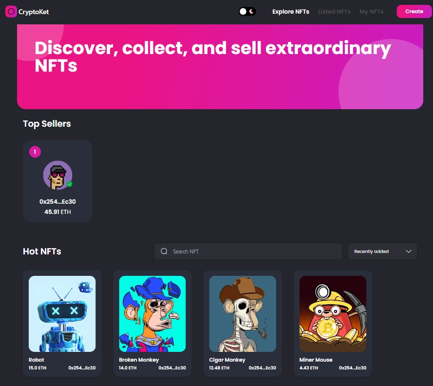
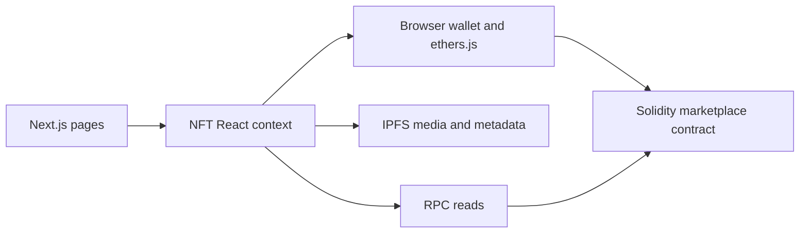

# CryptoKet · NFT Marketplace

**Explore the connection between a web interface, wallet transactions, and marketplace contracts.**

Next.js · Solidity · Hardhat · ethers.js · IPFS



## Purpose

This project demonstrates an NFT marketplace workflow across the frontend and contract layers. It is intended for developers studying wallet interaction, token metadata, and on-chain ownership rather than a production marketplace deployment.

## Implemented flows

- Connect a browser wallet through Web3Modal/MetaMask-compatible APIs.
- Upload media and metadata through an IPFS client.
- Create a token and offer it for sale.
- Browse marketplace items and inspect NFT details.
- Buy listed items and resell owned tokens.
- View owned and listed NFTs, with dark/light interface themes.

## Start the frontend

Open the source directory with Node.js/npm installed:

```bash
npm install
npm run dev
```

The interface runs at [localhost:3000](http://localhost:3000). Marketplace reads and transactions require the chain, contract, and storage setup below; starting the UI alone does not provide them.

## Configure the contract and storage

1. Review [`hardhat.config.js`](hardhat.config.js). It currently reads an absent `.secret` file at module load even though the resulting variable is unused by the included network configuration. Resolve that local configuration dependency before running Hardhat.
2. Use a local development chain and a disposable development wallet. Keep the wallet network aligned with the RPC endpoint used by the frontend.
3. Review [`scripts/deploy.js`](scripts/deploy.js) and deploy the included contract to that development chain.
4. Set the deployed contract address in [`context/constants.js`](context/constants.js) and keep its ABI aligned with the contract.
5. Configure a working IPFS upload service in [`context/NFTContext.js`](context/NFTContext.js). The embedded Infura endpoint may require current provider configuration and credentials.

After correcting the local Hardhat configuration, the existing development tools are:

```bash
npx hardhat compile
npx hardhat node
```

Run deployment in a separate terminal against the running local node:

```bash
npx hardhat run scripts/deploy.js --network localhost
```

## Architecture



The React context coordinates wallet state and marketplace operations. The contract records listings, ownership transitions, and sale prices; IPFS stores token metadata and media referenced by token URIs.

## Source guide

| Path | Responsibility |
|---|---|
| [`pages/`](pages/) | Browse, create, detail, ownership, and resale screens |
| [`components/`](components/) | Cards, forms, navigation, and dialogs |
| [`context/NFTContext.js`](context/NFTContext.js) | Wallet, contract, and IPFS integration |
| [`contracts/NFTMarketplace.sol`](contracts/NFTMarketplace.sol) | Token and marketplace logic |
| [`scripts/deploy.js`](scripts/deploy.js) | Contract deployment |

## Project boundaries

This repository uses older pinned framework and Web3 dependencies. The included sample test is not evidence of a marketplace security audit. Local configuration and external storage must be completed before the full flow is usable; use development assets while evaluating it.

Bootstrapped with [Next.js](https://nextjs.org/) and Hardhat. See the [Next.js documentation](https://nextjs.org/docs) for frontend framework guidance.
